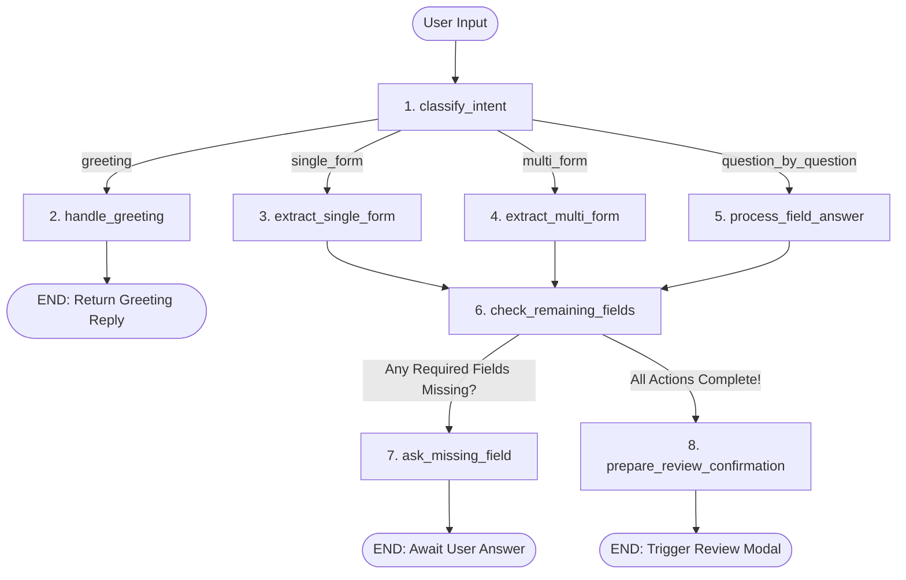

# LangGraph Flow Architecture: Unified Multi-Category Form Filling

## 1. Overview & The "Single Funnel" Concept

This architecture provides a unified conversational workflow for form-filling AI that smoothly handles four interaction types:
1. **Greeting / Chit-Chat:** Friendly pleasantries, capabilities check, and assistance queries.
2. **Single Form:** User selects a form directly or provides single-action paragraph details.
3. **Multi-Form:** Batch or compound requests spanning multiple records or multiple distinct forms in a single message.
4. **Question-by-Question:** Turn-by-turn interactive slot filling answering pending fields.

### The Unified State Principle
Instead of maintaining separate pipelines with redundant logic, all user inputs are normalized into a **unified list of actions** (`actions: List[FormAction]`):
* **Single Form:** An array of 1 action: `[Action_1]`
* **Multi-Form:** An array of $N$ actions: `[Action_1, Action_2, ...]`
* **Question-by-Question:** Simply fills the active slot in `actions[current_action_index]["fields"][current_field_name]`

Because all inputs converge into this standard representation, a **single missing-field validation engine** and a **single question generator** handle all three data-entry modes.

---

## 2. LangGraph State Schema (`AgentState`)

```python
from typing import TypedDict, List, Dict, Any, Optional

class FormAction(TypedDict):
    id: str                         # Unique ID, e.g. "act_1_a8f9c2"
    form_key: str                   # Form identifier, e.g. "raise_complaint", "visitor_entry"
    form_name: str                  # Human-readable title, e.g. "Raise Complaint"
    title: str                      # Concise label, e.g. "Tap Leakage (Flat 101)"
    fields: Dict[str, Any]          # Extracted key-values: {"flat_number": "101", ...}
    missing_fields: List[str]       # Required field labels still missing: ["Urgency"]
    is_complete: bool               # True if all required fields are present
    schema: Dict[str, Any]          # Snapshot of form definition and fields from DB

class AgentState(TypedDict):
    # Session & Input
    user_message: str
    chat_id: Optional[str]
    
    # Intent category
    # Values: "greeting" | "single_form" | "multi_form" | "question_by_question"
    intent: str
    
    # Unified Action Store (Works for single, multi, and step-by-step)
    actions: List[FormAction]
    shared_context: Dict[str, Any]  # Global ambient details (e.g. {"resident_name": "Priya", "flat_number": "101"})
    
    # Active pointer for Question-by-Question slot filling
    current_action_index: int       # Index in `actions` currently being filled
    current_field: Optional[Dict[str, Any]] # Field metadata currently being prompted
    
    # Final Response Payload
    reply: str                      # Message to return to frontend
    status: str                     # "greeting" | "in_progress" | "ready" | "cancelled"
    ready_for_review: bool          # Flag to open frontend confirmation/review modal
    is_batch: bool                  # True if multiple actions are prepared
```

---

## 3. Workflow Graph



---

## 4. Nodes Detail

### Node 1: `classify_intent` (The Router)
* **Input:** `user_message`, `current_field`, active `actions`
* **Logic:**
  1. If `current_field` is not None and user is in an active session $\rightarrow$ **`question_by_question`**
  2. If message is a pure greeting/smalltalk ("hi", "hello", "can you help me") $\rightarrow$ **`greeting`**
  3. If user mentions multiple records, multiple flats, or compound actions (e.g. 2 visitors + 1 complaint) $\rightarrow$ **`multi_form`**
  4. If user requests a specific form or describes a single issue $\rightarrow$ **`single_form`**
* **Output:** Updates `state["intent"]`.

---

### Node 2: `handle_greeting`
* **Input:** `user_message`
* **Logic:**
  * Uses conversational LLM prompt to generate a polite, natural 1-sentence reply.
  * Suggests possible actions (raising complaints, logging visitor entries, adding notices).
  * Does not activate any form state.
* **Output:** Sets `reply`, `status = "greeting"`, `ready_for_review = False`. Routes to `END`.

---

### Node 3: `extract_single_form`
* **Input:** `user_message`
* **Logic:**
  * Detects `form_key` from user text and database schema.
  * Fetches the form schema from SQLite `forms` and `form_fields`.
  * Extracts any stated field values from the user's message.
  * Populates `state["actions"] = [single_action]`.
  * Resets `current_action_index = 0`.
* **Output:** Updates `actions`. Routes directly to `check_remaining_fields`.

---

### Node 4: `extract_multi_form`
* **Input:** `user_message`
* **Logic:**
  * Calls `multi_form_planner.plan_and_extract(user_message)`:
    * Breaks text into multiple target form actions.
    * Inherits `shared_context` across actions (e.g., flat number or resident name).
    * Extracts fields for each distinct action.
  * Populates `state["actions"] = [act_1, act_2, ...]`.
  * Sets `is_batch = True`.
* **Output:** Updates `actions`, `shared_context`. Routes directly to `check_remaining_fields`.

---

### Node 5: `process_field_answer`
* **Input:** `user_message`, `current_action_index`, `current_field`
* **Logic:**
  * Takes the user's response to the active question.
  * Validates and normalizes against the target field type (select options, numeric flat numbers, text sanitization).
  * If user replied "skip" for an optional field, marks it skipped / null.
  * Writes value into `actions[current_action_index]["fields"][current_field["name"]]`.
* **Output:** Updates active action fields. Routes directly to `check_remaining_fields`.

---

### Node 6: `check_remaining_fields` (Universal Missing Engine)
* **Input:** `state["actions"]`
* **Logic:**
  1. Iterates through all actions in `state["actions"]`.
  2. Compares each action's current fields against its required schema fields:
     $$\text{missing} = \{ \text{f.label} \mid \text{f.required is True and f.name is empty} \}$$
  3. Updates `action["missing_fields"]` and `action["is_complete"]`.
  4. **Decision:**
     * **If all actions are complete:**
       * Sets `ready_for_review = True`, `current_field = None`.
       * Routes to **`prepare_review_confirmation`**.
     * **If any action is incomplete:**
       * Finds the first incomplete action $\rightarrow$ updates `current_action_index`.
       * Identifies its first missing field $\rightarrow$ sets `current_field`.
       * Routes to **`ask_missing_field`**.

---

### Node 7: `ask_missing_field`
* **Input:** `current_action_index`, `current_field`, `actions`
* **Logic:**
  * Formulates a natural, polite question for `current_field`.
  * **Contextual Framing:**
    * Single Form: *"Got that! Could you please share your **[Field Label]**?"*
    * Multi-Form: *"I've drafted 3 items. For **[Action Title]**, could you provide the **[Field Label]**?"*
  * If field has options, smoothly presents them.
* **Output:** Sets `reply`, `status = "in_progress"`, `ready_for_review = False`. Routes to `END` to wait for user input.

---

### Node 8: `prepare_review_confirmation`
* **Input:** `state["actions"]`, `state["is_batch"]`
* **Logic:**
  * Generates a final readiness message:
    * Single Form: *"🎉 All details have been extracted for **[Form Name]**! Please review and confirm in the popup modal."*
    * Multi-Form: *"🎉 Identified and extracted **[N] items**! Please review and confirm in the popup modal."*
  * Sets `ready_for_review = True`, `status = "ready"`, `current_field = None`.
* **Output:** Final response payload. Routes to `END`.

---

## 5. End-to-End Walkthrough Examples

### Scenario A: Single Form with Missing Fields
1. **User:** `"There is a water leak in kitchen"`
2. **`classify_intent`** $\rightarrow$ detects `single_form` (no active question, single intent).
3. **`extract_single_form`** $\rightarrow$ initializes action `raise_complaint` with `category="Water"`, `details="water leak in kitchen"`.
4. **`check_remaining_fields`** $\rightarrow$ checks required fields: `flat_number` and `urgency` are missing.
5. **`ask_missing_field`** $\rightarrow$ asks: *"Sorry to hear about the leak! Which flat number is this for?"*
6. **User:** `"Flat B-302, it is urgent"`
7. **`classify_intent`** $\rightarrow$ sees active question $\rightarrow$ routes to `process_field_answer`.
8. **`process_field_answer`** $\rightarrow$ parses `flat_number="B-302"` and `urgency="High"`.
9. **`check_remaining_fields`** $\rightarrow$ all required fields present! Routes to `prepare_review_confirmation`.
10. **`prepare_review_confirmation`** $\rightarrow$ flags `ready_for_review = True`, modal opens on UI.

---

### Scenario B: Multi-Form Batch with Missing Details
1. **User:** `"Register visitor Rahul for flat 101, and fix lift light in C wing"`
2. **`classify_intent`** $\rightarrow$ detects `multi_form` (2 distinct actions).
3. **`extract_multi_form`** $\rightarrow$ drafts 2 actions:
   - Action 1: `visitor_entry` (visitor: Rahul, flat: 101, missing: vehicle number or purpose).
   - Action 2: `raise_complaint` (wing: C wing, issue: lift light, missing: urgency).
4. **`check_remaining_fields`** $\rightarrow$ detects Action 1 is missing `vehicle_number`.
5. **`ask_missing_field`** $\rightarrow$ asks: *"I've noted Rahul's visit to 101 and the lift issue. Does Rahul have a vehicle number (or enter skip)?"*
6. **User:** `"MH12 AB 1234, urgency for lift is high"`
7. **`process_field_answer`** $\rightarrow$ updates vehicle number for Action 1 and urgency for Action 2.
8. **`check_remaining_fields`** $\rightarrow$ all actions complete! Routes to `prepare_review_confirmation`.
9. **`prepare_review_confirmation`** $\rightarrow$ triggers batch review modal displaying both records.

---

## 6. Key Advantages of This Design

1. **Unified Maintenance:** All missing-field logic lives in one place (`check_remaining_fields`). Adding validation rules or database schema changes updates all categories automatically.
2. **Context Preservation:** If a user provides information for multiple fields or even another form while answering a specific question, the extractor naturally absorbs it without getting stuck.
3. **State Consistency:** The frontend always receives a uniform payload structure (`actions`, `status`, `current_field`, `ready_for_review`) whether the user used single, batch, or question-by-question flow.

